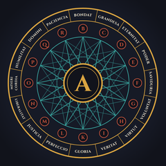
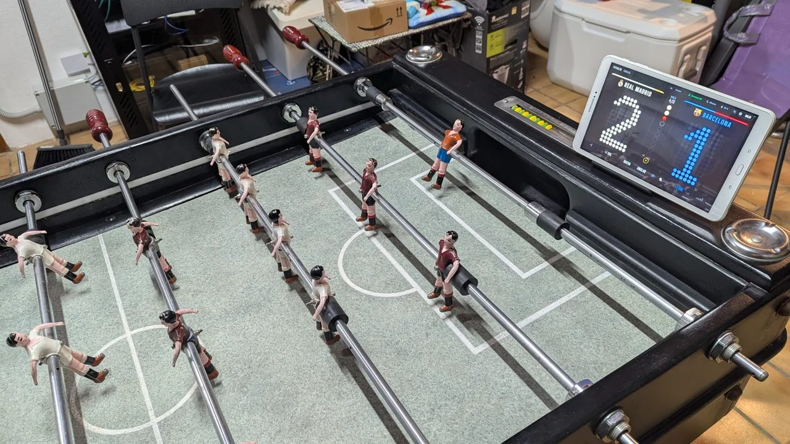
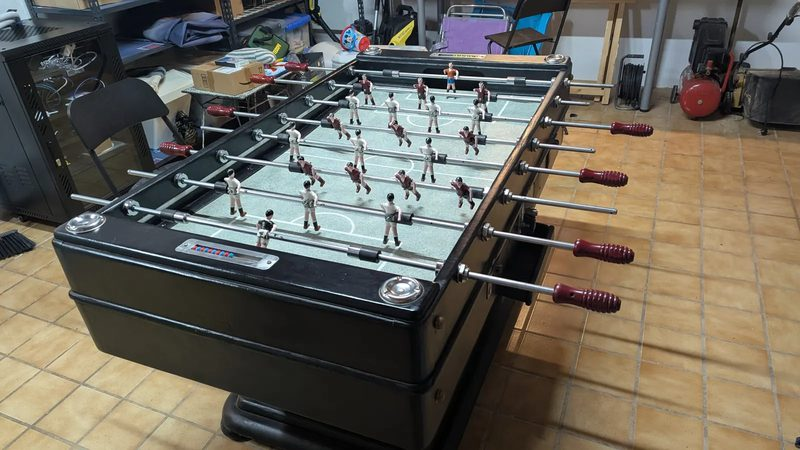
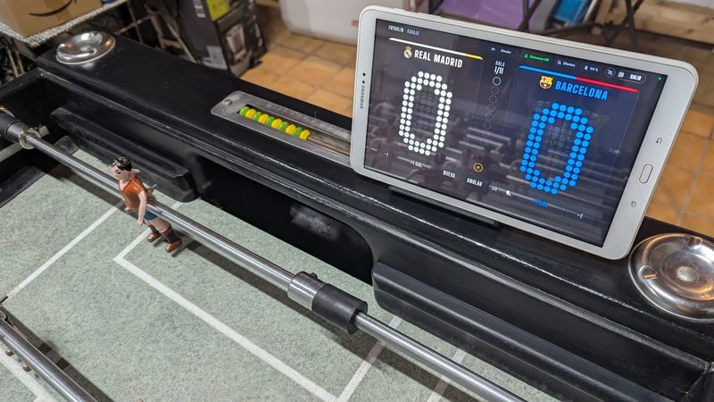

  
  &nbsp;&nbsp;&nbsp;
  

<h1 align="center">Futbolín con Home Assistant</h1>

  Un futbolín clásico (un Córdoba antiguo restaurado) que cuenta los goles solo, los canta con un locutor y celebra cada gol con luces, sin que por fuera se note nada.

  
  

  
  
  

  

Fotos, vídeo y esquemas en la web, también en [català](https://arsmagnalab.com/ca/futbolin/) y en [English](https://arsmagnalab.com/en/futbolin/).

## Qué hace

- **Cuenta los goles solo.** Una barrera infrarroja en cada carril de recogida de bolas detecta la bola al pasar. Sin taladrar la portería y sin nada que se vea por fuera.
- **Lleva la partida.** 11 bolas, gana quien llega a 6, y con 5-5 se juega «la buena». Un ESP32 con ESPHome sigue contando aunque se caigan la WiFi o Home Assistant.
- **Marcador en una tablet.** Dashboard de Home Assistant con aspecto de marcador de estadio: dígitos de matriz de puntos, la columna de las 11 bolas y animaciones de gol, «la buena» y victoria.
- **Locutor.** Cada gol se narra con una frase distinta y con jugadores reales, y cada partida empieza con una presentación del clásico. La música de fondo baja mientras habla.
- **Control por voz.** «Nueva partida», «gol del Madrid», «quita un gol al Barça»… con Assist, en local.
- **Luces.** Dos tiras LED con WLED hacen efectos puntuales: la ola del gol cruza el campo hacia la portería rival y hay fiesta al ganar. Si la batería baja se apagan solas y se sigue jugando sin ellas. Con la buena, un latido dorado que se acelera hasta el gol que decide.
- **A batería.** Sin cables mientras se juega. El aspecto exterior no cambia, salvo un interruptor discreto por debajo. Home Assistant recuerda apagarlo si nadie juega y cargar las baterías antes de que se estropeen.

<table>
  <tr>
    <td width="50%"></td>
    <td width="50%"></td>
  </tr>
  <tr>
    <td align="center">Por fuera, el mismo futbolín de siempre</td>
    <td align="center">El marcador, en la tablet</td>
  </tr>
</table>

## Cómo está hecho

| Parte | Qué es |
|---|---|
| Sensores de gol | Barreras IR (break-beam) protegidas por dos cuñas de madera en cada carril |
| Cerebro | ESP32 con ESPHome: interrupciones, antirrebote, aviso de atasco y autotest al arrancar |
| Pantalla y voz | Home Assistant en una tablet, con un dashboard propio y Assist |
| Luces | Controlador Gledopto con WLED, dos tiras WS2811 de 12 V y presets lanzados por el ESP32 |
| Energía | Baterías de plomo de 12 V, convertidor a 5 V y medida de la batería en el ESP32 |

## Contenido del repositorio

| Carpeta | Qué hay |
|---|---|
| [`docs/`](docs/README.md) | Cómo funciona: reglas, detección de gol, hardware, pines, cableado, contrato de entidades y diagramas. Maqueta del marcador para abrir en el navegador |
| [`esphome/`](esphome/README.md) | Firmware del ESP32: partida, barreras por interrupción, batería y efectos de luz |
| [`homeassistant/`](homeassistant/README.md) | Paquetes (simulación, secuencia de goles, locutor, voz, música), dashboard del marcador, escudos y tipografía |
| [`wled/`](wled/README.md) | Generador de los presets de luz y script para cargarlos en WLED |
| [`locutor/`](locutor/README.md) | Generador de las locuciones del locutor y de los sonidos de reserva |

## Cómo empezar

1. **Hardware**: barreras IR en los carriles, ESP32, buck, baterías y tiras. Pines, esquemas y montaje en [`docs/README.md`](docs/README.md). Conviene probar antes las barreras en un banco en la mesa.
2. **ESPHome**: copia `esphome/secrets.example.yaml` como `secrets.yaml`, pon tus claves y graba `esphome/futbolin.yaml` en el ESP32. Dalo de alta en Home Assistant con la integración de ESPHome.
3. **Home Assistant**: instala button-card, copia los paquetes, los ficheros de `www/` y el dashboard, y adapta las entidades de la tablet y la música. Detalle en [`homeassistant/README.md`](homeassistant/README.md). Con el botón «Simular» se puede probar todo sin el futbolín.
4. **WLED**: genera y carga los presets en el controlador de las tiras con `wled/cargar_presets.py --ip <ip-del-wled>` y pon esa IP en `secrets.yaml` (`wled_ip`).
5. **Locutor**: genera las locuciones con el TTS de tu Home Assistant (`HA_URL` y `HA_TOKEN`) y cópialas a `/config/www/futbolin/sonidos/locutor/`. Ver [`locutor/README.md`](locutor/README.md).

Los nombres de equipo, escudos, colores, frases y jugadores son los de un Real Madrid – Barcelona; cambiarlos es cuestión de editar el dashboard, las frases de voz y las listas del locutor.

## Licencia

[MIT](LICENSE). Los escudos de los equipos son marcas de sus clubes, el logo de Home Assistant es de sus dueños, y ni ellos ni las fotos y el logo de Ars Magna Lab están cubiertos por esta licencia; la tipografía Big Shoulders Display (que se descarga aparte) es SIL OFL.
