# Cómo funciona

Un futbolín clásico (un Córdoba antiguo restaurado) que cuenta los goles solo. Las barreras infrarrojas de los carriles de recogida detectan cada gol, un ESP32 con ESPHome lleva la partida y Home Assistant la muestra en una tablet y la controla por voz. Las tiras LED, con WLED, celebran los goles. Todo va a batería y oculto dentro del mueble.

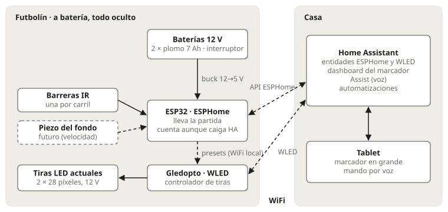

## Principios

- **La portería no se toca.** Nada sobresale en la cavidad: la bola es maciza y rápida, y cualquier sensor ahí acabaría roto o devolviendo la bola.
- **Aspecto exterior intacto.** Por fuera solo se añade un interruptor general discreto, por debajo.
- **Sin enchufe mientras se juega.** Baterías de 12 V dentro del mueble; opcionalmente, una fuente de 12 V en su lugar (modo enchufado).
- **Sin botones en el futbolín.** Todo se controla desde Home Assistant: dashboard, voz o cualquier otro accionador.
- **El recuento no depende de nada externo.** La partida vive en el ESP32: si HA o la WiFi caen, sigue contando. Los efectos de luz van del ESP32 a WLED directos por la WiFi local, sin pasar por HA.
- **HA es el centro de control y la pantalla**, pero no lleva la partida.

## Reglas de juego

- 11 bolas por partida. Gana quien llega a **6 goles**.
- **5-5 = «la buena»**: la última bola se saca en medio. Momento especial con efectos.
- Nueva partida, correcciones (+1 / −1 por equipo) y anular partida: desde HA.
- Tras el sexto gol se **ignoran los goles** hasta la siguiente «nueva partida» (las bolas sobrantes se meten a mano para recogerlas).

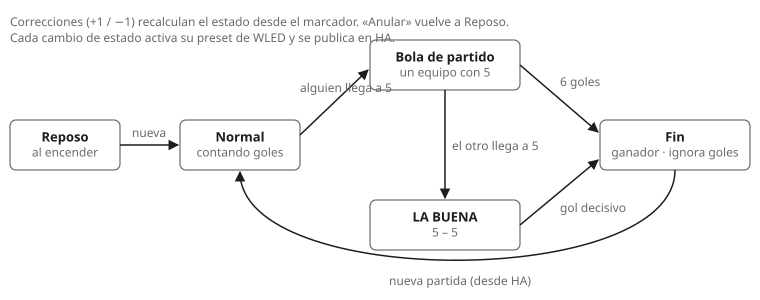

Fases que publica el ESP32: `reposo` (al encender), `normal`, `bola_partido_a`, `bola_partido_b`, `la_buena`, `fin_a`, `fin_b`. Las correcciones recalculan la fase a partir del marcador (por ejemplo, −1 desde 6-5 vuelve a bola de partido y se reanuda la cuenta).

## Detección de gol

Se detecta en el **carril de recogida**, no en la portería: ahí la bola rueda por gravedad, siempre por el mismo camino, sea cual sea la fuerza del disparo.

- **Una barrera IR (break-beam) por carril**: emisor de 940 nm y receptor enfrentados, pegados a las paredes del carril justo detrás de **dos cuñas de madera** en ángulo recto (rampa suave de entrada, cara recta a la salida). La bola nunca toca los sensores y el haz cruza todo el ancho, así que la corta pase por donde pase. Sin taladrar el futbolín.
- **Posición**: por debajo de la caída, donde la bola ya rueda (en el original, a unos 21 cm del final del carril: más arriba, las bolas muy rápidas pasaban sin cortar el haz de forma limpia), y por encima de la cola de bolas acumuladas.
- **Firmware**: interrupción directa en el ESP32 que mide en microsegundos cuánto dura cada corte. Un corte de menos de 0,5 ms es ruido; tras cada gol hay un bloqueo de 400 ms; si el haz lleva tapado más de 2 s, aviso de atasco.
- **Autotest** al arrancar: cada emisor se alimenta desde su propio GPIO (~10 mA a 3,3 V); se apagan y se comprueba que los receptores ven «tapado», y al encenderlos, «libre».

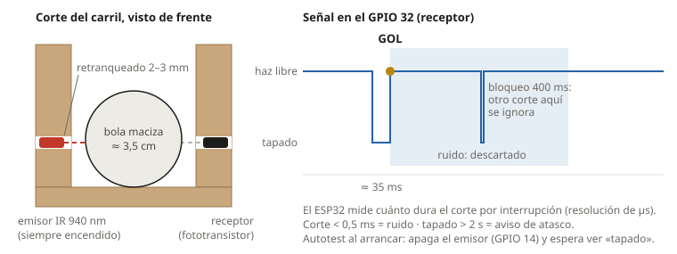
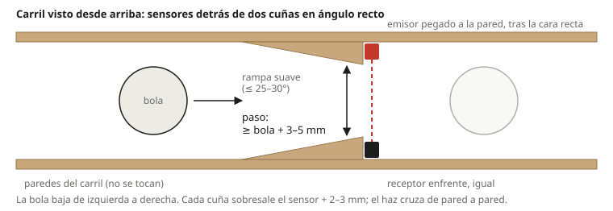
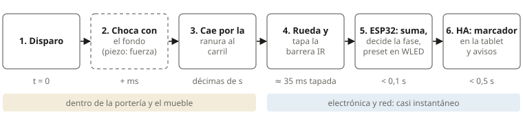

## Hardware

| Pieza | Qué es |
|---|---|
| ESP32 DevKit (WROOM-32) | Con ESPHome, sobre una placa de bornas de tornillo |
| Barreras IR | 2 pares break-beam de 3–5 V (tipo Adafruit 2167), uno por carril |
| Controlador de tiras | Gledopto GL-C-015WL-M (ESP32 con WLED de fábrica, 5–24 V), una tira por salida |
| Tiras LED | 2 tiras WS2811 de 12 V, 60 LED/m (un píxel cada 3 LEDs), 28 píxeles por lado |
| Baterías | 2 × plomo 12 V 7 Ah en paralelo, con un fusible de 5 A cada una; interruptor general por debajo del mueble |
| Buck 12 → 5 V | LM2596 ajustable (HW-319) a 5,0 V para el ESP32 y los sensores |
| Medida de batería | Divisor de 100 kΩ / 20 kΩ (10 k + 10 k) al GPIO 34 (ADC1: el ADC2 no funciona con WiFi); el multiplicador se calibra con un multímetro |
| Pantalla y voz | Una tablet con el dashboard de HA y Assist |

### Pines del ESP32

| Función | GPIO |
|---|---|
| Receptor gol A (Madrid) / B (Barcelona), pull-up externo de 5,1 kΩ y 1 kΩ en serie | 32, 33 |
| Emisor IR A / B, alimentado por el pin (autotest) | 14, 27 |
| Batería (ADC1) | 34 |
| Reservados para ampliaciones (ADC1) | 35, 36 |
| Reservados para velocidad con haces | 16, 17, 18, 19 |
| I2C reservado para ampliaciones | 21, 22 |

Las entradas de gol van siempre por interrupción directa al ESP32, nunca por un expansor I2C (añadiría latencia).

### Cableado y alimentación

El ESP32, el buck, el bus de 12 V y la interfaz (resistencias y divisor soldados en el cable) van en un panel de contrachapado junto a las baterías. A cada carril llega un cable de 5 hilos que acaba en dos conectores JST-SM de 3 pines (receptor y emisor), con GND siempre en el pin central.

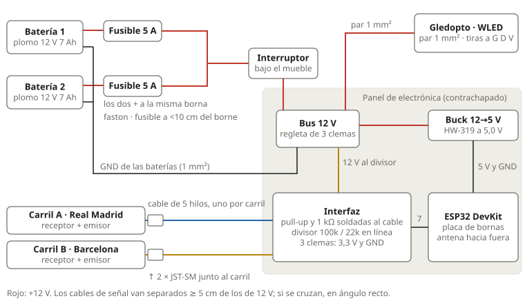
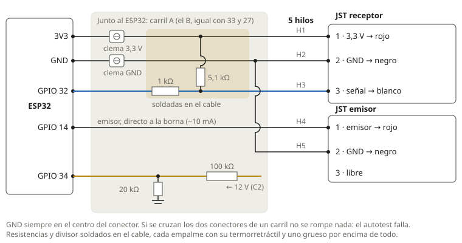
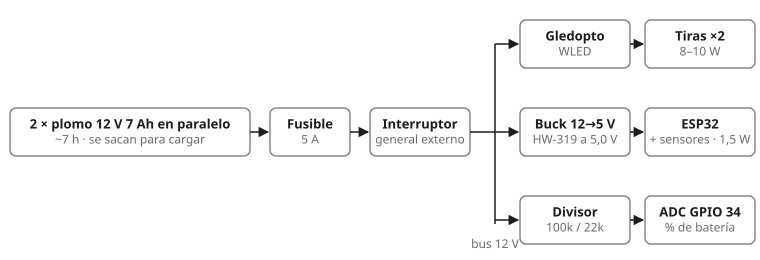
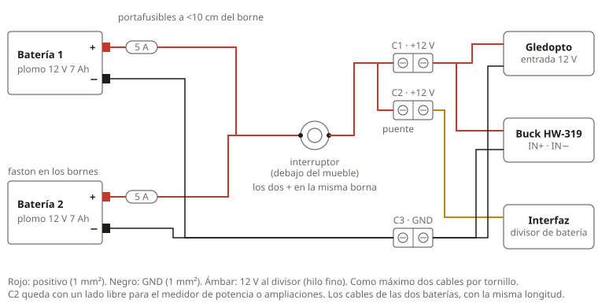
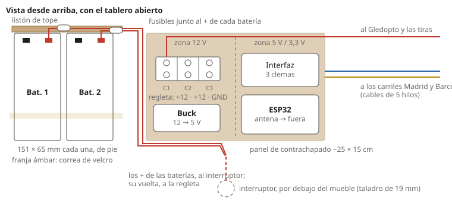
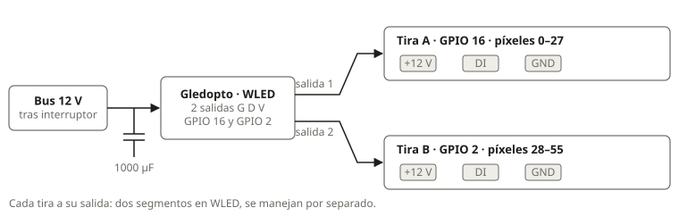

**Modo enchufado**: en lugar de las baterías se conecta una fuente de 12 V a los cables de una batería, detrás de su fusible (nunca fuente y baterías a la vez). En HA, `switch.futbolin_modo_enchufado` oculta la batería y silencia sus avisos.

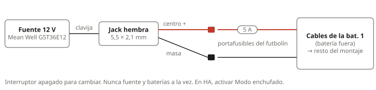

**Consumo**: las tiras gastan demasiado para ir encendidas toda la partida con batería, así que solo hacen **efectos puntuales** (gol, bola de partido, la buena y victoria). Con las baterías de plomo, el ESP32 corta las luces si la batería baja de un mínimo configurable.

Para montar el banco de pruebas en la mesa antes de llevarlo al futbolín:

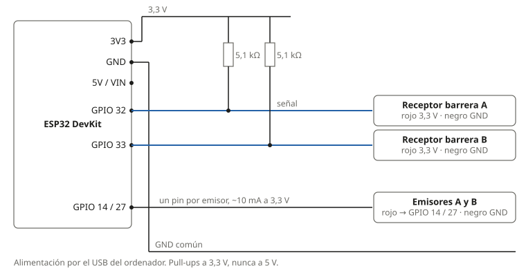
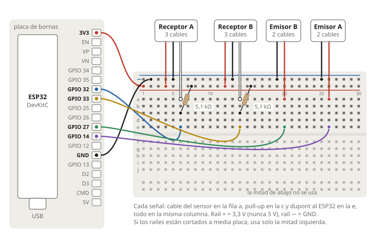

## Contrato de entidades

Nombre del dispositivo ESPHome: `futbolin`. Las entidades quedan en HA como `<dominio>.futbolin_<nombre>`. Equipos: **A** (Real Madrid) y **B** (FC Barcelona).

### Estado de la partida

| Entidad | Tipo | Valores | Notas |
|---|---|---|---|
| `sensor.futbolin_goles_a` / `_b` | sensor | 0–6 | |
| `sensor.futbolin_fase` | text_sensor | `reposo`, `normal`, `bola_partido_a`, `bola_partido_b`, `la_buena`, `fin_a`, `fin_b` | `reposo` al encender con el interruptor; tras un reinicio (OTA, caída de tensión) sigue la partida, guardada en la flash |
| `event.futbolin_gol` | event | `gol_a`, `gol_b` | Solo los goles que ven las barreras (no los +1 de HA), y no los ignorados tras el sexto |

### Sensores y diagnóstico

| Entidad | Tipo | Notas |
|---|---|---|
| `sensor.futbolin_bateria_voltios` | sensor (V) | Divisor al GPIO 34 |
| `sensor.futbolin_bateria` | sensor (%) | Tabla de tensión a % del plomo en reposo. Usa la tensión más alta de los últimos 10 min, porque con las tiras encendidas el plomo cae ~0,5 V |
| `binary_sensor.futbolin_atasco_a` / `_b` | binary_sensor | Haz tapado más de 2 s |
| `binary_sensor.futbolin_luces_cortadas_por_bateria` | binary_sensor | Las tiras están apagadas por batería baja |
| `binary_sensor.futbolin_autotest` | binary_sensor | on = OK |
| `binary_sensor.futbolin_haz_a` / `_b` | binary_sensor | on = tapado (desactivado por defecto) |
| `sensor.futbolin_corte_a` / `_b` | sensor (ms) | Duración del último corte |
| `sensor.futbolin_ruido_a` / `_b` | sensor | Cortes descartados por cortos desde el arranque |
| `sensor.futbolin_rebotes_a` / `_b` | sensor | Cortes descartados por el bloqueo de 400 ms |
| `sensor.futbolin_ultimo_corte` | text_sensor | `#12 A 35,2 ms gol`: el registro de HA queda como diario de la partida |
| `sensor.futbolin_autotest_detalle` | text_sensor | `A OK · B …` |
| `sensor.futbolin_senal_wifi`, `sensor.futbolin_encendido`, `sensor.futbolin_ip`, `button.futbolin_reiniciar` | | Diagnóstico. `encendido` llega cada 5 s y hace de latido |

### Controles (HA → ESP32)

| Entidad | Efecto |
|---|---|
| `button.futbolin_nueva_partida` | 0-0, fase `normal` |
| `button.futbolin_gol_a_mas` / `_b_mas` | +1 a ese equipo (gol no detectado) |
| `button.futbolin_gol_a_menos` / `_b_menos` | −1 a ese equipo (gol mal contado) |
| `button.futbolin_anular_partida` | Anula la partida y vuelve a `reposo` |
| `button.futbolin_autotest` | Repite el autotest de las barreras |
| `switch.futbolin_modo_enchufado` | Modo con fuente de 12 V: oculta la batería y silencia sus avisos |
| `switch.futbolin_efectos_luz` | Apagado: el ESP32 apaga las tiras y deja de mandar presets (HA puede seguir manejándolas) |
| `number.futbolin_luces_bateria_minima` | % por debajo del cual se cortan las luces (5–60, 25 por defecto). Vuelven al subir al mínimo + 10 |

### Tiras (ESP32 → WLED)

El ESP32 activa **presets de WLED** con `POST http://<ip-del-wled>/json/state` y `{"ps": <id>}`, directo por la WiFi local. La IP va en `esphome/secrets.yaml` como `wled_ip`. Si WLED no responde, el gol se cuenta igual.

Si tu WiFi aísla a los clientes entre sí (redes de invitados o IoT con aislamiento), el ESP32 no llegará al WLED: deja pasar el tráfico entre los dos.

Presets, cuándo se mandan y cómo se generan: `wled/README.md`.

### Entidades propias de HA

Las calcula el paquete de HA para el dashboard y la voz (secuencia de goles, último gol, latido, simulación): ver `homeassistant/README.md`.

## Ideas futuras

Diagrama de una propuesta que no está montada: medir la velocidad del disparo con dos haces en la boca de la portería (`img/velocidad-haces.svg`). Otras ideas: batería LiFePO4 para pasar de 8 h, ranking de jugadores, botonera Zigbee y el marcador en la tele.

Los diagramas se regeneran con `python3 docs/img/diagramas.py`.

La maqueta del marcador (`maqueta/marcador.html`) se abre directamente en el navegador para ver el diseño sin Home Assistant (atajos en la URL: `#5-5`, `#gol-a`…).
